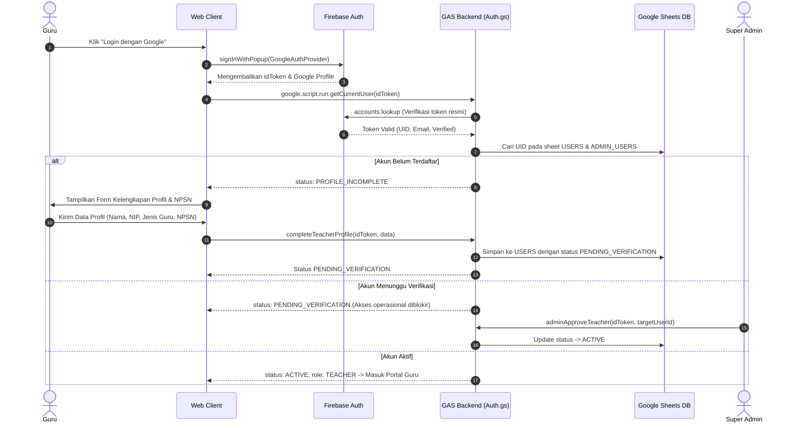

# PRODUCT REQUIREMENTS DOCUMENT (PRD)
# PORTAL ADMINISTRASI GURU SD
**Versi:** 1.0  
**Target Pengguna Awal:** Kecamatan Ambulu, Kabupaten Jember  
**Arsitektur:** Multi-teacher Educational Administration SaaS (Google Apps Script + Google Sheets + Firebase Auth + Google Drive)

---

## 1. Ringkasan Eksekutif & Latar Belakang
Portal Administrasi Guru SD adalah platform web terpadu yang dirancang untuk mendigitalkan seluruh beban administratif guru sekolah dasar (guru kelas maupun guru mata pelajaran), meliputi pengelolaan kelas, biodata siswa, presensi digital berbasis QR Code dan manual, penyusunan perangkat pembelajaran (CP, TP, ATP, Modul Ajar), jurnal mengajar harian, agenda jadwal, asesmen/kuis, penginputan dan pengolahan nilai formatif-sumatif, serta penyusunan buku rapor Kurikulum Merdeka secara otomatis.

Aplikasi ini melayani banyak guru dari berbagai sekolah secara multitenant dengan prinsip **Isolasi Data Penuh**:
1. Guru A tidak dapat melihat atau mengedit data milik Guru B, sekalipun mereka mengajar di sekolah yang sama.
2. Super Admin hanya mengelola operasional platform (verifikasi guru, data referensi sekolah, pustaka perangkat ajar pusat, pengumuman, dan audit log), dan secara tegas **DILARANG** mengakses atau memanipulasi administrasi akademik guru.

---

## 2. Persona & Pembagian Peran

### 2.1 Super Admin (Platform Operator)
- Memverifikasi pendaftaran guru baru dan validasi NPSN sekolah.
- Mengelola data direktori sekolah se-Kecamatan Ambulu / Kabupaten Jember.
- Menyediakan pustaka referensi materi/perangkat ajar pusat dari Google Drive.
- Mempublikasikan pengumuman platform dan memantau tiket bantuan (helpdesk).
- Memantau statistik pertumbuhan pengguna dan meninjau audit logs sistem.

### 2.2 Guru (Primary Operator)
- Mengelola kelas yang diampu (Tingkat 1 s.d. 6, semester ganjil/genap, tahun ajaran aktif).
- Mengelola data induk siswa, mutasi, serta impor data massal dari Excel.
- Menjalankan sesi presensi dengan QR Code berbatas waktu (token hash) dan presensi manual.
- Menyusun jadwal pelajaran, perangkat ajar, dan jurnal harian mengajar.
- Menginput nilai (Formatif, Sumatif, Tugas, Proyek, Praktik, Ujian) dan mencetak lembar rapor PDF.

---

## 3. Matriks Hak Akses & Keamanan Data

| Modul / Fitur | Hak Akses Super Admin | Hak Akses Guru | Catatan Keamanan |
|---|---|---|---|
| Dashboard | Agregat Platform | Personal Guru | Filter mutlak `owner_user_id` pada query |
| Verifikasi Guru | Setujui / Tolak / Tangguhkan | Tidak Memiliki Akses | Memeriksa NPSN & keabsahan guru |
| Data Sekolah | CRUD Direktori Sekolah | Read-Only (Dropdown) | NPSN unik, identitas resmi Kemdikbud |
| Data Kelas | Dilarang Mengakses | CRUD Kelas Sendiri | Hanya pemilik kelas yang bisa manipulasi |
| Data Siswa | Dilarang Mengakses | CRUD Siswa Sendiri | Validasi NIS/NISN dalam kelas |
| Presensi Siswa | Dilarang Mengakses | CRUD Presensi Sendiri | QR dinamis, validasi token hash & anti scan ganda |
| Nilai & Asesmen | Dilarang Mengakses | CRUD Nilai Sendiri | Validasi kepemilikan asesmen & siswa |
| Jurnal & Perangkat | Dilarang Mengakses | CRUD Dokumen Sendiri | Guru dapat mengimpor referensi dari pustaka pusat |
| Pustaka Pusat | Kelola (Google Drive) | Read & Salin Referensi | File Drive terverifikasi, bukan publik sembarangan |
| Pengumuman | Buat & Publikasikan | Membaca Pengumuman | Filter target audiens (guru/sekolah) |
| Audit Trail | Membaca Log Sistem | Menghasilkan Log Aktivitas | Semua operasi penting dicatat otomatis |

---

## 4. Alur Autentikasi & Verifikasi Akun

---

## 5. Kebutuhan Antarmuka (UI/UX)
Mengacu secara presisi pada rancangan visual standar:
- **Warna Utama**: Deep Navy `#142B4A`, Accent Royal Blue `#2563EB`, Background `#F5F7FB`, Surface White `#FFFFFF`.
- **Status Warna**: Success `#16A34A`, Warning `#D97706`, Danger `#DC2626`.
- **Header**: Breadcrumbs dinamis, Pill Tahun Pelajaran Aktif `2026/2027`, Dark/Light Mode Switch, Bel Notifikasi interaktif, Foto Profil Pengguna.
- **Hero Banner Dashboard Guru**: Sapaan personal ("Selamat Pagi, [Nama Guru]!"), Pill identitas sekolah ("🏫 [Nama Sekolah] | Kelas yang diampu: [Nama Kelas]"), serta grafis tematik SD Negeri.
- **5 Kartu Metrik Cepat**: Jumlah Siswa, Hadir Hari Ini, Kelas yang Diampu, Perangkat Ajar, dan Administrasi Perlu Diselesaikan.
- **Visualisasi & Tabel**: Grafik Kehadiran 7 Hari Terakhir (interaktif), Jadwal Pembelajaran Hari Ini dengan status badge (Selesai, Berlangsung, Menunggu), Aktivitas Terbaru, Widget Akses Cepat, Peringatan Administrasi, dan Pengumuman Sekolah.
- **Responsivitas**: Adaptif untuk Desktop, Tablet, dan Mobile (Bottom navigation & Drawer tanpa horizontal overflow).
